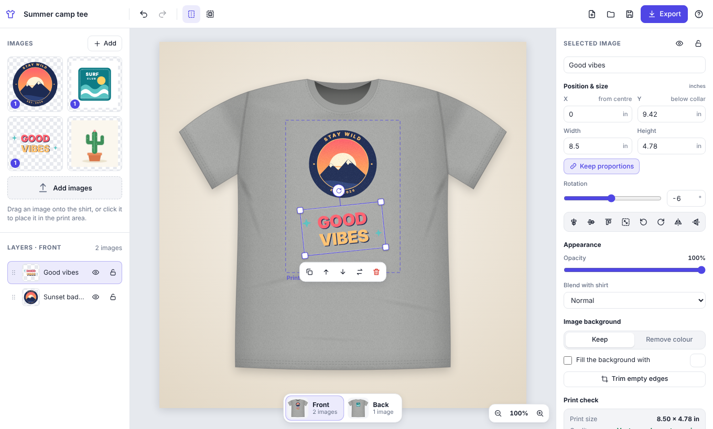
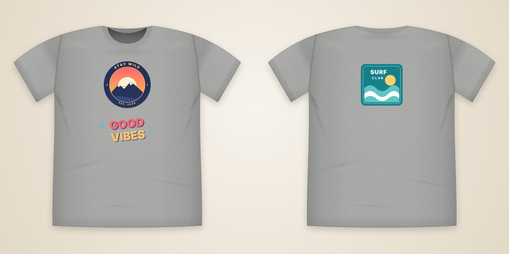
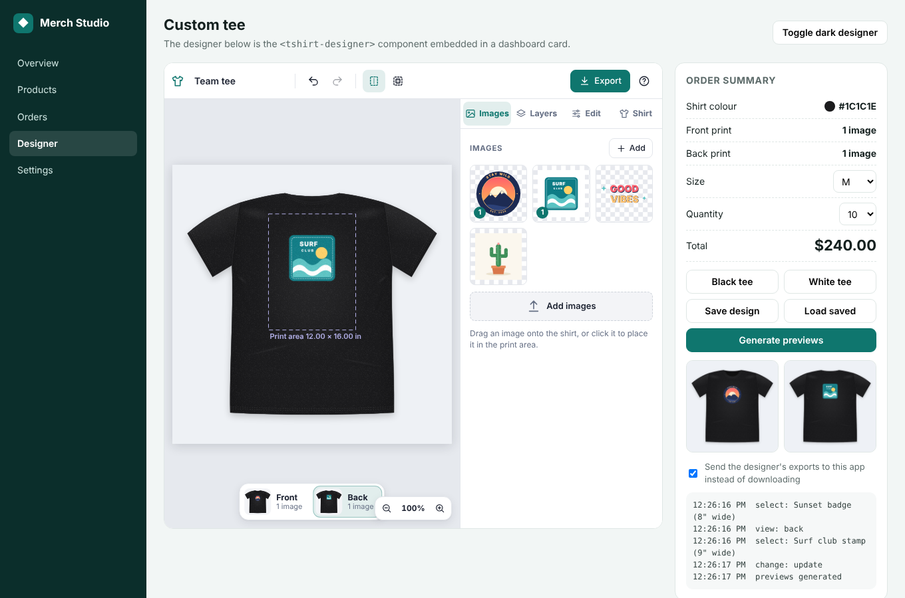

# T‑Shirt Designer

A browser-based tool for placing artwork on a T‑shirt. Add several images, drag them onto the **front or back** of the shirt, then **move, resize and rotate** them. Pick the **shirt colour** and the **background** behind it, remove solid image backgrounds, and **export** mockups and print‑ready files in standard formats.

It ships as a single, dependency‑free **web component** — `<tshirt-designer>` — so it works as a **standalone page** *and* as a **section inside another project or dashboard** (React, Vue, Angular, plain HTML, or an `<iframe>`).



---

## Contents

- [Features](#features)
- [Quick start](#quick-start)
- [Using the designer](#using-the-designer)
- [Embedding it in your project](#embedding-it-in-your-project)
- [Attributes](#attributes)
- [JavaScript API](#javascript-api)
- [Events](#events)
- [Export formats](#export-formats)
- [Theming](#theming)
- [Keyboard shortcuts](#keyboard-shortcuts)
- [Design file format](#design-file-format)
- [Browser support](#browser-support)
- [Development](#development)

## Features

**Designing**
- Image library: add many images at once (button, drag & drop from the desktop, or paste), then **drag them onto the shirt** (mouse, pen or touch) or click to place.
- Move, resize (corner handles keep proportions; Shift = free, Alt = from centre) and rotate (Shift snaps to 15°). Two‑finger pinch/rotate on touch screens.
- Smart guides snap to the centre line, the print‑area edges and other images.
- **Front and back** views with live thumbnails; copy an image to the other side in one click.
- Layers panel: reorder by dragging, show/hide, lock. Duplicate, flip, align, fit to print area, opacity, blend modes.
- Undo/redo, zoom & pan, keyboard shortcuts, autosave (optional).

**Shirt & background**
- 20 preset shirt colours plus any custom colour, with realistic folds, seams, rib collar and cotton texture that also shade your artwork.
- Background: solid colour, radial gradient, your own image, or none (transparent).

**Images with or without transparent backgrounds**
- PNG/WebP/SVG transparency is respected.
- For images with a **solid background** (e.g. a JPEG logo on white) the designer detects it and offers **Remove colour**: auto‑detect or eyedropper, tolerance, edge softness, and *“only areas touching the edges”* so whites inside the artwork survive. Edges are de‑haloed.
- Optionally **fill** the background with another colour, and **trim** transparent margins.

**Print awareness**
- Positions are shown the way print shops specify them: **X from the centre line** and **Y below the collar**, in inches or centimetres.
- Configurable print area (12 × 16 in standard, 10 × 12, 14 × 16, 15 × 18, 8 × 10 or custom).
- Per‑image **DPI check** and warnings when artwork falls outside the print area.

**Export** — PNG, JPEG, WebP, SVG (vector shirt), PDF (mockups with placement specs + true‑size print sheets), ZIP (everything) and a re‑editable JSON design file. Print files are true size with the DPI embedded.



## Quick start

**Standalone:** open `index.html` in a browser — that's it (it even works straight from disk). Click **Try sample images** to play with the included artwork.

Or serve the folder (handy for the iframe example):

```bash
npm start
```

Then visit http://localhost:8080.

**In your page:**

```html
<script src="tshirt-designer.js"></script>

<tshirt-designer style="height: 720px"></tshirt-designer>
```

The component fills the box you give it and adapts its layout to that size: three columns when wide, the stage plus a tabbed sidebar in medium boxes such as dashboard cards, and stacked panels on phones.

## Using the designer

1. **Add images** with the *Add* button, by dropping files onto the library, or by pasting (Ctrl/⌘+V). Drop files directly on the shirt to place them where you drop.
2. **Drag** a thumbnail from the library onto the shirt (or click it to place it in the print area).
3. **Select** an image to move it, drag the corner handles to resize, and the round handle to rotate. The floating toolbar duplicates, reorders, copies to the other side, or deletes.
4. Switch between **Front** and **Back** with the switcher under the shirt.
5. In **Shirt**, choose the shirt colour, the background and the print area.
6. If an image has a solid background, use **Image background → Remove colour** in the *Selected image* panel (the designer suggests it automatically).
7. **Export** a mockup, print files, a PDF or everything as a ZIP. **Save** the design file (JSON) to keep editing later; **Open** loads it back.

## Embedding it in your project

### As a web component (recommended)

Load the script once, then use the tag anywhere. Styles are isolated in Shadow DOM, so the component won't clash with your app's CSS.

```html
<script src="/vendor/tshirt-designer.js"></script>

<tshirt-designer id="designer" shirt-color="#1f2a44" hide="file" style="height: 680px"></tshirt-designer>

<script>
  const designer = document.getElementById('designer');

  designer.addEventListener('tsd-change', (e) => console.log('changed:', e.detail.reason, e.detail.summary));

  // Upload exports to your server instead of downloading them
  designer.addEventListener('tsd-export', async (e) => {
    e.preventDefault();
    await fetch('/api/designs/files', { method: 'POST', body: e.detail.blob });
  });

  // Persist the design in your own backend
  async function save() {
    await fetch('/api/designs/42', { method: 'PUT', body: JSON.stringify(designer.getDesign()) });
  }
</script>
```

It works the same inside React (`<tshirt-designer ref={ref} />`), Vue and Angular — load the script and use the element; call methods through a ref. See [`examples/dashboard.html`](examples/dashboard.html) for a full dashboard integration (live order summary from events, external buttons driving the API, intercepted exports, custom brand colour).



### As an iframe (no script integration needed)

```html
<iframe src="https://your-host/tshirt/index.html?bridge=https://your-app.example&exports=parent" style="width:100%;height:720px;border:0"></iframe>
```

With `?bridge=<allowed origin>` the standalone page accepts commands via `postMessage` from that origin only, and forwards events back:

```js
frame.contentWindow.postMessage({ tsd: 'call', id: 1, method: 'setShirtColor', args: ['#000000'] }, 'https://your-host');
// → { tsd: 'result', id: 1, result }   and   { tsd: 'event', type: 'tsd-change', detail }
```

With `&exports=parent`, exported files are posted to the parent as Blobs instead of downloading. See [`examples/iframe.html`](examples/iframe.html). Other URL parameters: `theme`, `shirt-color`, `background`, `view`, `units`, `print-area`, `hide`, `name`, `readonly=1`, `autosave=0`.

## Attributes

| Attribute | Example | Description |
|---|---|---|
| `shirt-color` | `#1f2a44` | Shirt colour (any CSS colour). |
| `background` | `#eef1f5`, `transparent`, `gradient(#fff, #ccd)` | Scene background behind the shirt. |
| `view` | `front` / `back` | Side shown. |
| `units` | `in` / `cm` | Measurement units in the UI. |
| `print-area` | `12x16` | Print area in inches (centred, under the collar). |
| `theme` | `light` / `dark` / `auto` | UI theme (`auto` follows the OS). Default `light`. |
| `name` | `Team tee` | Design name (used for file names). |
| `hide` | `file,export` | Hide UI parts: `toolbar`, `library`, `layers`, `properties`, `shirt`, `export`, `file`, `history`, `sides`, `zoom`, `name`, `help`, `guides`. |
| `readonly` | | View‑only preview (no editing; export still available). |
| `autosave` | `my-key` | Keep the design in this browser (IndexedDB) under that key and restore it on load. |
| `src` | `/designs/42.json` | Load a saved design on start. |
| `samples` | `a.png,b.svg` | Image URLs offered by the *Try sample images* button (or set the `samples` property to an array). |
| `max-image-size` | `4096` | Larger raster uploads are downscaled to this many pixels on the long side. |

## JavaScript API

Geometry is in **model units**: the artboard is 1000 × 1000 units and **26 units = 1 inch**. Layers also report a convenient `inches` object.

| Member | Description |
|---|---|
| `ready` | Promise that resolves when the designer has initialised. |
| `view` / `setView(side)` | Get/set `'front'` or `'back'`. |
| `shirtColor` / `setShirtColor(color)` | Get/set the shirt colour. |
| `background` / `setBackground(spec)` | `'transparent'`, a colour, or `{ type: 'solid' \| 'gradient' \| 'image' \| 'transparent', color, color2, image }` (`image` may be a File, Blob, URL or data URL). Returns a Promise. |
| `setPrintArea(w, h)` | Print area in inches. |
| `addImage(source, options)` | Add an image (File, Blob, URL, data URL, SVG markup, ``, `<canvas>`). Options: `place` (default `true`), `side`, `x`/`y` or `at`, `width` (inches), `name`. Resolves to `{ assetId, layerId }`. |
| `addImages(sources, options)` | Add several images. |
| `getLayers(side?)`, `getLayer(id)` | Layer objects (copies), including `inches: { width, height, xFromCenter, yBelowCollar }`. |
| `updateLayer(id, patch)` | Change `x`, `y`, `w`, `h`, `rotation`, `flipX`, `flipY`, `opacity`, `blend`, `visible`, `locked`, `lockAspect`, `name`, `fill`, `bg: { mode: 'keep' \| 'remove', color, tolerance, softness, edgesOnly }`. |
| `selectLayer(id \| null)`, `selectedLayer` | Selection. |
| `removeLayer(id)`, `clear(side?)`, `reset()` | Remove images / start over. |
| `undo()`, `redo()`, `canUndo`, `canRedo` | History. |
| `getDesign()` / `loadDesign(json)` | Save/restore the full design (images embedded as data URLs). Also available as the `design` property. |
| `export(options)` | Render files without downloading → `[{ blob, filename, side }]`. |
| `exportImage(options)`, `exportSVG()`, `exportPDF()`, `exportZip()` | Convenience wrappers returning a `Blob`. |
| `download(options)` | Export and download (fires `tsd-export` first). |
| `openExportDialog(options?)` | Open the built‑in export dialog. |
| `zoomToFit()`, `setZoom(z)` | View controls. |

```js
const d = document.querySelector('tshirt-designer');
await d.ready;
const { layerId } = await d.addImage(fileInput.files[0], { side: 'front', width: 10 });
d.updateLayer(layerId, { rotation: -8, bg: { mode: 'remove', tolerance: 20 } });
const png = await d.exportImage({ side: 'combined', width: 2000 });
const pdf = await d.exportPDF({ sheets: true, dpi: 300, page: 'a4' });
```

## Events

All events bubble, cross the shadow boundary (`composed`) and carry data in `event.detail`.

| Event | Detail |
|---|---|
| `tsd-ready` | `{ version }` |
| `tsd-change` | `{ reason, summary: { name, shirtColor, background, printArea, front, back, canUndo, canRedo } }` (debounced) |
| `tsd-select` | `{ layer, side }` (`layer` is `null` when nothing is selected) |
| `tsd-view` | `{ view }` |
| `tsd-export` | `{ blob, filename, format, side, options }` — **cancelable**: `preventDefault()` stops the download so you can handle the Blob. |
| `tsd-error` | `{ message, error }` |

## Export formats

| Format | Content | Notes |
|---|---|---|
| **PNG** | Mockup, or print file | Mockups up to 4000 px per side; optional transparent background. Print files contain only the artwork at true size (e.g. 12 × 16 in at 300 DPI = 3600 × 4800 px) with transparency and the DPI embedded. |
| **JPEG** | Mockup, or print file | Smallest files; print files are flattened on white and carry the DPI. |
| **WebP** | Mockup, or print file | When the browser can encode WebP. |
| **SVG** | Mockup | Vector shirt with images embedded; opens in Illustrator, Inkscape, Figma and browsers. |
| **PDF** | Mockups + specs + print sheets | One page per side with exact placement measurements, plus optional true‑size print sheets (lossless, with transparency). Letter or A4. |
| **ZIP** | Everything | Mockups (PNG + SVG), print files, the PDF, the design file and a README with the placements. |
| **JSON** | Design file | Re‑open with *Open* or `loadDesign()`. |

Sides: current, front, back, both (separate files) or both side by side in one image. Blend modes are a mockup preview; for print transparency use *Remove colour*.

## Theming

Override CSS custom properties on the element:

```css
tshirt-designer {
  height: 100vh;
  border-radius: 0;
  --tsd-accent: #0f766e;
  --tsd-accent-hover: #115e59;
  --tsd-accent-soft: rgba(15, 118, 110, .12);
  --tsd-font: Inter, system-ui, sans-serif;
}
```

Other tokens: `--tsd-bg`, `--tsd-surface`, `--tsd-surface-2`, `--tsd-border`, `--tsd-text`, `--tsd-muted`, `--tsd-stage`, `--tsd-radius`. Set `theme="dark"` (or `auto`) for the dark palette. Styleable parts: `::part(base)`, `::part(toolbar)`, `::part(stage)`, `::part(sidebar-left)`, `::part(sidebar-right)`.

## Keyboard shortcuts

| Action | Keys |
|---|---|
| Move selected image | Arrow keys (Shift = 10×) |
| Duplicate / delete | Ctrl/⌘ + D · Delete |
| Copy / paste | Ctrl/⌘ + C · Ctrl/⌘ + V (also pastes images from the clipboard) |
| Undo / redo | Ctrl/⌘ + Z · Ctrl/⌘ + Shift + Z (or Ctrl + Y) |
| Layer order | `[` `]` (Shift = to back / front) |
| Zoom | Ctrl/⌘ + scroll · `+` `−` · `0` to fit |
| Pan when zoomed | drag empty space · Space + drag · scroll |
| Disable snapping | hold Alt while dragging |
| Export · save | Ctrl/⌘ + E · Ctrl/⌘ + S |

Shortcuts only apply while the designer has focus, so they never interfere with the host page.

## Design file format

```jsonc
{
  "format": "tshirt-designer", "version": 1, "name": "Team tee",
  "shirt": { "color": "#1f2a44", "shading": true },
  "background": { "type": "gradient", "color": "#f4efe6", "color2": "#d6c4a2", "image": null },
  "printArea": { "width": 12, "height": 16, "unit": "in" },
  "unitsPerInch": 26,
  "sides": {
    "front": { "layers": [ { "id": "l_…", "asset": "a_…", "name": "logo", "x": 500, "y": 330, "w": 218, "h": 218,
                             "rotation": 0, "flipX": false, "flipY": false, "opacity": 1, "blend": "normal",
                             "visible": true, "locked": false, "lockAspect": true, "crop": null,
                             "bg": { "mode": "remove", "color": "#ffffff", "tolerance": 18, "softness": 30, "edgesOnly": true },
                             "fill": null } ] },
    "back": { "layers": [] }
  },
  "library": ["a_…"],
  "assets": { "a_…": { "name": "logo", "type": "image/png", "width": 1200, "height": 1200, "src": "data:image/png;base64,…" } }
}
```

## Browser support

Built for current Chrome, Edge, Firefox and Safari (desktop and mobile); the automated tests run in Chromium. It uses Custom Elements, Shadow DOM, Canvas 2D, Pointer Events and `<dialog>`. Lossless PDF print sheets use `CompressionStream` (they fall back to high‑quality JPEG where it is missing), and WebP export appears only where the browser can encode it. Very large exports are scaled down automatically on devices with canvas size limits (e.g. iOS), and you're told when that happens.

## Development

```
tshirt-designer.js     the component (single file, no dependencies)
index.html             standalone page (+ optional postMessage bridge)
assets/samples/        sample artwork  ·  assets/samples.js  the same, inlined for file://
examples/              dashboard.html (web component)  ·  iframe.html (iframe + postMessage)
tests/e2e.test.cjs     end-to-end tests (Playwright)
scripts/serve.cjs      tiny static server for `npm start`
docs/                  screenshots
```

```bash
npm install
npx playwright install chromium
npm test
```

The tests drive the real component in headless Chromium: dragging from the library, handles, keyboard, background removal, every export format (validating PNG DPI, PDF structure, ZIP entries, SVG rendering), autosave, responsive layouts and both embedding examples.
